<p>
<picture>
  <source media="(prefers-color-scheme: light)" srcset="assets/banner/hero-v2-light.svg">
  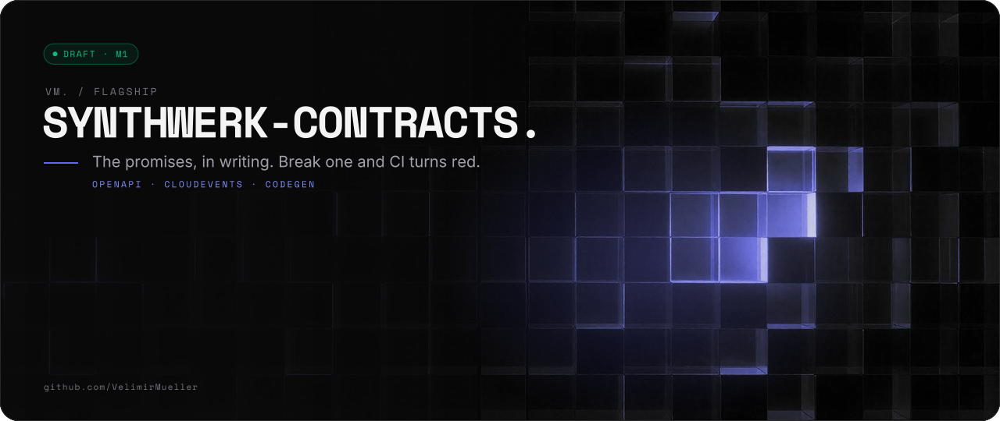
</picture>
</p>

<p>
<picture>
  <source media="(prefers-color-scheme: light)" srcset="assets/readme/lead-v2-light.svg">
  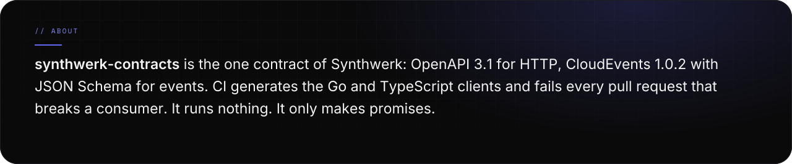
</picture>
</p>

<p>
<picture>
  <source media="(prefers-color-scheme: light)" srcset="assets/readme/stats-v2-light.svg">
  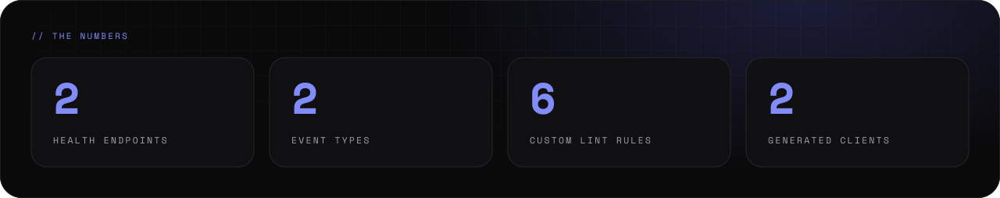
</picture>
</p>

<br>

<p>
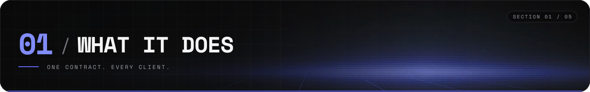
</p>

<p>
<picture>
  <source media="(prefers-color-scheme: light)" srcset="assets/readme/features-v2-light.svg">
  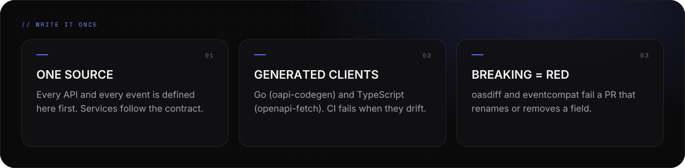
</picture>
</p>

<p>
<picture>
  <source media="(prefers-color-scheme: light)" srcset="assets/readme/what-v2-light.svg">
  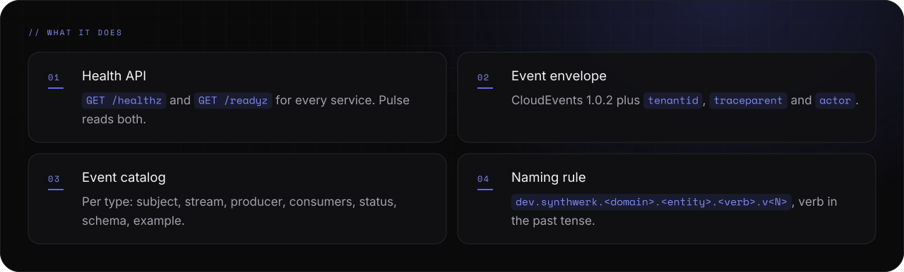
</picture>
</p>

<br>

<p>
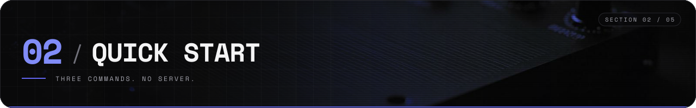
</p>

<p>
<picture>
  <source media="(prefers-color-scheme: light)" srcset="assets/readme/start-v2-light.svg">
  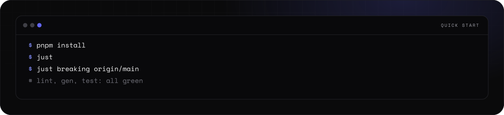
</picture>
</p>

<p>
<picture>
  <source media="(prefers-color-scheme: light)" srcset="assets/readme/setup-v2-light.svg">
  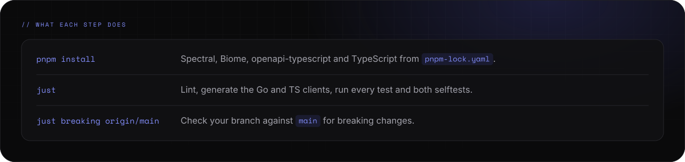
</picture>
</p>

<p>
<picture>
  <source media="(prefers-color-scheme: light)" srcset="assets/readme/startnotes-v2-light.svg">
  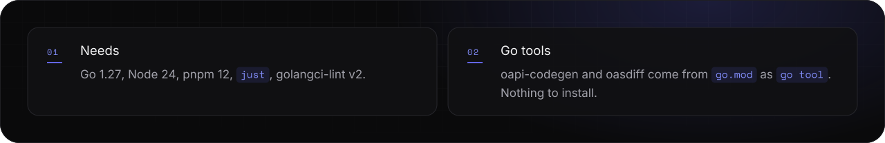
</picture>
</p>

<details>
<summary><picture><source media="(prefers-color-scheme: light)" srcset="assets/readme/links-7-v2-light.svg">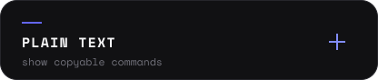</picture></summary>

```bash
pnpm install                 # Spectral, Biome, openapi-typescript, TypeScript
just                         # lint, gen, test
just breaking origin/main    # breaking-change check against main
```

</details>

<p align="center">
<a href="docs/naming.md"><picture><source media="(prefers-color-scheme: light)" srcset="assets/readme/links-1-v2-light.svg">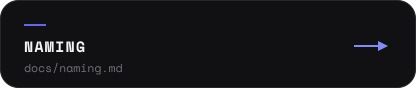</picture></a>
<a href="docs/developer-guide.md"><picture><source media="(prefers-color-scheme: light)" srcset="assets/readme/links-2-v2-light.svg">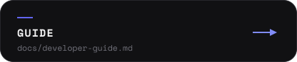</picture></a>
<a href="docs/features/"><picture><source media="(prefers-color-scheme: light)" srcset="assets/readme/links-3-v2-light.svg"></picture></a>
</p>

<br>

<p>
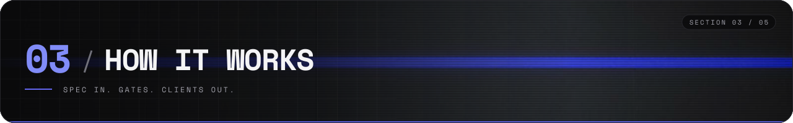
</p>

<p>
<picture>
  <source media="(prefers-color-scheme: light)" srcset="assets/readme/flow-v2-light.svg">
  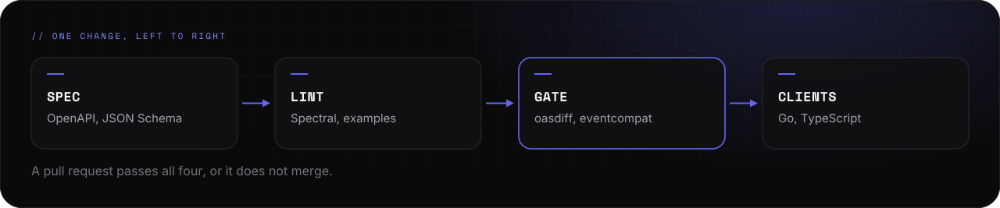
</picture>
</p>

<p>
<picture>
  <source media="(prefers-color-scheme: light)" srcset="assets/readme/how-v2-light.svg">
  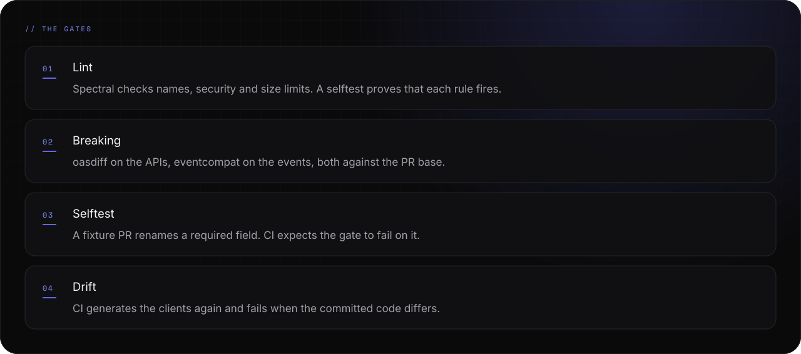
</picture>
</p>

<br>

<p>
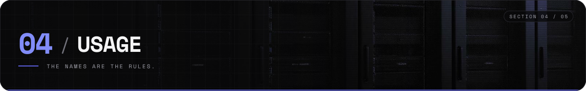
</p>

<p>
<picture>
  <source media="(prefers-color-scheme: light)" srcset="assets/readme/api-v2-light.svg">
  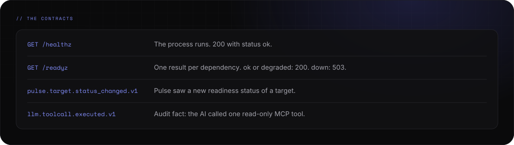
</picture>
</p>

<p>
<picture>
  <source media="(prefers-color-scheme: light)" srcset="assets/readme/naming-v2-light.svg">
  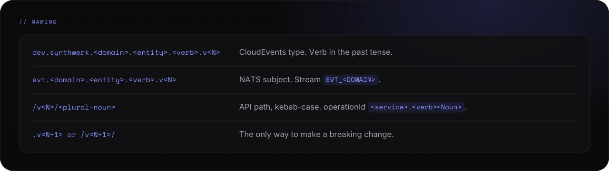
</picture>
</p>

<p>
<picture>
  <source media="(prefers-color-scheme: light)" srcset="assets/readme/reference-v2-light.svg">
  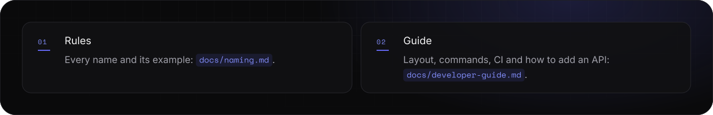
</picture>
</p>

<p align="center">
<a href="openapi/_shared/health.yaml"><picture><source media="(prefers-color-scheme: light)" srcset="assets/readme/links-4-v2-light.svg">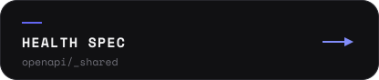</picture></a>
<a href="events/catalog.yaml"><picture><source media="(prefers-color-scheme: light)" srcset="assets/readme/links-5-v2-light.svg">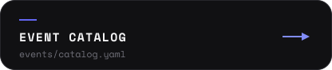</picture></a>
<a href="LICENSE"><picture><source media="(prefers-color-scheme: light)" srcset="assets/readme/links-6-v2-light.svg"></picture></a>
</p>

<br>

<p>
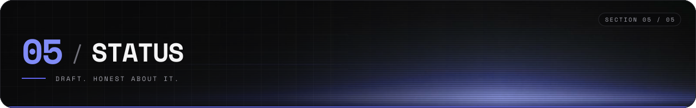
</p>

<p>
<picture>
  <source media="(prefers-color-scheme: light)" srcset="assets/readme/status-v2-light.svg">
  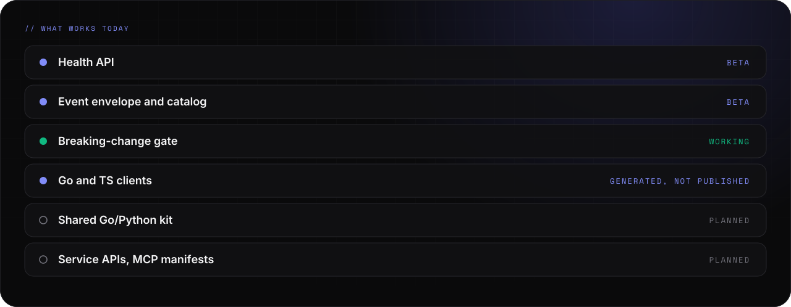
</picture>
</p>

<p>
<picture>
  <source media="(prefers-color-scheme: light)" srcset="assets/readme/now-v2-light.svg">
  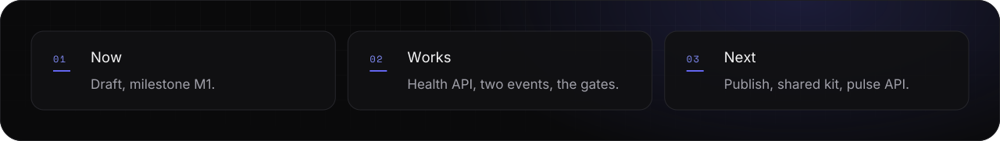
</picture>
</p>

<p>
<picture>
  <source media="(prefers-color-scheme: light)" srcset="assets/readme/checks-v2-light.svg">
  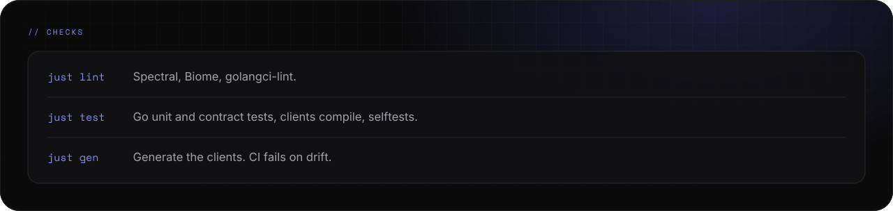
</picture>
</p>

<details>
<summary><picture><source media="(prefers-color-scheme: light)" srcset="assets/readme/links-7-v2-light.svg"></picture></summary>

```bash
just lint    # Spectral, Biome, golangci-lint
just test    # Go unit + contract tests, clients compile, selftests
just gen     # generate the clients; CI fails on drift
```

</details>

<p>
<picture>
  <source media="(prefers-color-scheme: light)" srcset="assets/readme/footer-v2-light.svg">
  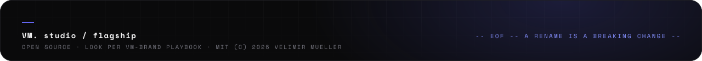
</picture>
</p>
